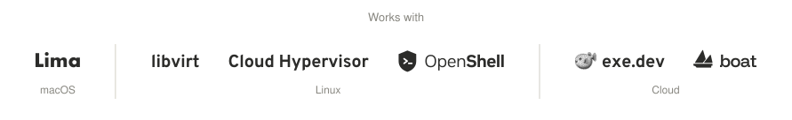
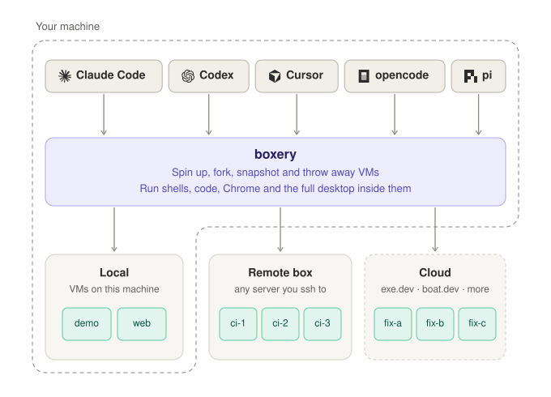
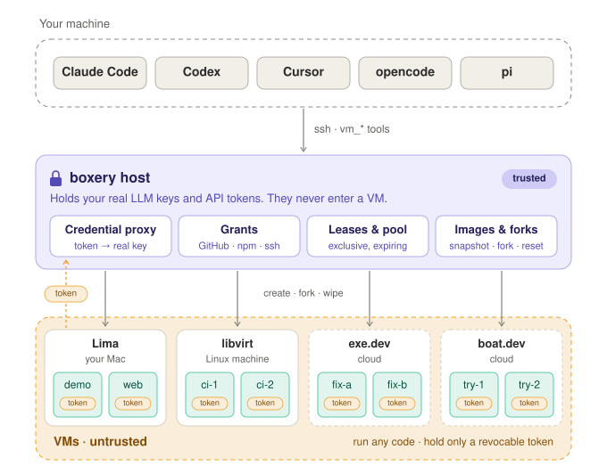
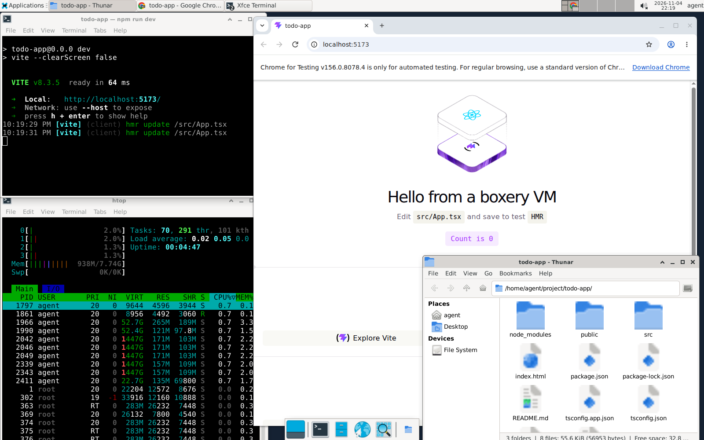

<h1 align="center">
  <picture>
    <source media="(prefers-color-scheme: dark)" srcset="docs/brand/lockup-dark.svg">
    
  </picture>
</h1>

<p align="center">
  <strong>Dev environments your agents spin up themselves, on any provider (local, remote, and cloud).</strong><br>
  Claude Code, Codex and any MCP agent can create, fork and throw away full Linux desktop VMs, with the same tools on every backend. Your credentials stay on a host you run and never enter a VM.
</p>

<p align="center">
  <a href="#where-the-vms-run">
    <picture>
      <source media="(prefers-color-scheme: dark)" srcset="docs/works-with-dark.svg">
      
    </picture>
  </a>
</p>

<p align="center">
  <a href="https://github.com/benvinegar/boxery/actions/workflows/ci.yml"></a>
  
  <a href="https://www.npmjs.com/package/boxery-vm"></a>
  <a href="#where-the-vms-run"></a>
  <a href="docs/mcp.md"></a>
</p>

<p align="center">
  <a href="docs/install.md">Install</a> ·
  <a href="docs/mcp.md">MCP server</a> ·
  <a href="docs/pi-extension.md">pi extension</a> ·
  <a href="docs/cli.md">CLI</a> ·
  <a href="host/backends/README.md">Backends</a> ·
  <a href="docs/README.md">All docs</a>
</p>

<p align="center">
  <picture>
    <source media="(prefers-color-scheme: dark)" srcset="docs/hero-dark.svg">
    
  </picture>
</p>

---

Your agent keeps running where it already runs, with your model login and your setup. boxery gives it **`vm_*` tools** that act on full Ubuntu desktop VMs: shell, files, a real Chrome, and the whole desktop. It can install things, run dev servers, click through UIs and fork itself into parallel attempts, all away from your laptop.

It works with every MCP-capable coding agent, including **Claude Code**, **Codex**, Cursor and opencode, and has a native [pi](https://pi.dev) extension. You can also run agents *inside* the VMs, where they keep working while your laptop sleeps.

## Getting started

Paste this into Claude Code, Codex or any coding agent on the machine you want to use:

```text
Install boxery (https://github.com/benvinegar/boxery) on this machine and spin up a VM for me.

1. Read https://raw.githubusercontent.com/benvinegar/boxery/master/docs/install.md
2. Pick the backend for this machine: Lima on macOS, libvirt on Linux with /dev/kvm.
   If neither fits, stop and ask me whether to use exe.dev or boat.dev.
3. Install the prerequisites and `npm install -g boxery-vm`, then run
   `boxery-host init` (with the right --backend) and `boxery-host build-base`,
   then `boxery setup local`. Ask me before running anything with sudo.
4. Create a VM with `boxery new demo`, run `uname -a` in it with `boxery run`,
   and open its desktop with `boxery desktop demo`.
5. Finally, connect yourself to boxery with `npx add-mcp boxery-vm`
   (or `pi install npm:boxery-vm` if you are pi), and tell me to restart you
   so the vm_* tools load.
```

`build-base` takes about 3 minutes. To do it by hand instead, see the [Quick start](#quick-start).

## Where the VMs run

boxery has two parts: the **[boxery host](#the-boxery-host)**, a machine you run that keeps your credentials, grants and leases, and the **VMs** your agent drives. The host can run the VMs itself if it has a hypervisor, or drive VMs in the cloud. Pick where you want the VMs to run:

| VMs run on | The boxery host runs on | Backend | Status |
|---|---|---|---|
| Your Mac | The same Mac | [`lima`](docs/install.md#macos-host-lima) | Stable |
| A physical Linux machine (KVM) | The same machine | [`libvirt`](docs/install.md#linux-host-libvirtkvm), [`cloud-hypervisor`](docs/install.md#linux-host-cloud-hypervisor-experimental) | libvirt: stable, fastest. Cloud Hypervisor: experimental |
| exe.dev (cloud) | Your local machine, or any remote machine with ssh (e.g. VPS) | [`exe`](docs/install.md#exedev-experimental) | Experimental |
| boat.dev (cloud) | Your local machine, or any remote machine with ssh (e.g. VPS) | [`boat`](docs/install.md#boatdev-experimental) | Experimental |

**Which one?**

- **To try it out**, use the machine you're on: Lima on a Mac, libvirt on a Linux desktop or laptop. Everything stays local.
- **For the fastest VMs**, use a physical Linux machine: a home server, an old desktop, or a dedicated server. A VPS works only if it offers nested virtualization (check for `/dev/kvm`), and most don't.
- **With no hardware of your own**, run the VMs on exe.dev or boat.dev. The host can stay on your local machine, but it keeps a tunnel open to each VM and agents lose their LLM while it sleeps, so for long-running work put it on an always-on machine such as a small VPS.

Agents see the same tools on every backend. One MCP server can [route across several hosts](docs/hosts.md) at once, and one machine can run [two backends side by side](docs/install.md#a-second-backend-on-the-same-machine). More cloud backends are coming. The [backend contract](host/backends/README.md) is a single bash file, so adding a new provider is a self-contained job.

## The boxery host

The host is the part of boxery you run yourself (the `boxery-host` command). Your agent's `vm_*` tools reach it over ssh, and it drives the VMs. It exists because **the VMs are untrusted**: agents run arbitrary code in them, install packages and browse the web. So anything secret or long-lived stays one step away, on the host.

<p align="center">
  <picture>
    <source media="(prefers-color-scheme: dark)" srcset="docs/host-dark.svg">
    
  </picture>
</p>

- **Your credentials never enter a VM.** Agents running inside a VM call LLMs with a revocable per-VM token, and the host's proxy swaps in your real key. Remove the VM and its token is revoked. [Credential proxy →](docs/security.md#credential-proxy)
- **Access is granted, never assumed.** A VM gets nothing by default, not even an LLM. Grant it LLM providers (`llm:chatgpt`, …), specific HTTPS APIs (GitHub, npm, …) with the token injected by the host so it never enters the VM, your ssh-agent, or particular env vars and files. [Grants →](docs/grants.md)
- **Many agents, one pool.** The host hands out exclusive, expiring leases and wipes each VM back to a clean image when its lease ends. [Pool →](docs/pool.md)
- **Backends stay simple.** The host owns images, snapshots, forks and leases, and a backend only creates, copies and deletes VMs. That's why your agent sees the same tools on every backend, and why a new provider is a single bash file. [Backends →](host/backends/README.md)

The host runs on macOS or Linux, on your own machine or a remote one. Every VM is reachable as `NAME.boxery` through it, so `ssh demo.boxery`, VS Code Remote-SSH and Zed work too. More detail: [security model](docs/security.md) · [architecture](ARCHITECTURE.md).

## Why boxery

- **Same tools on every backend.** Move from your local machine to a Linux server to exe.dev or boat.dev without changing prompts, tools or workflow.
- **One MCP server, many hosts.** Keep quick work on your local machine, heavy work on a Linux server, and burst to the cloud, all from one server. [Named hosts →](docs/hosts.md)
- **Fork a running VM.** Copy a VM mid-task into several independent VMs so an agent can try three fixes in parallel and keep the one that works. Snapshots and forks are built on one image primitive that every backend implements. [Snapshots & forks →](docs/cli.md#snapshots-and-forks)
- **Fast, disposable desktops.** On libvirt, a new Ubuntu 24.04 + XFCE VM takes about 13 s, a snapshot about 1 s without pausing the VM, and a fork into several VMs 15–25 s. Tasks that need no GUI can use `boxery new NAME --headless`: no desktop, and no image build needed. [Headless VMs →](docs/cli.md#lifecycle)
- **Real computer use.** Screenshots, clicks, typing, and Playwright against Chrome on the VM's desktop. You can watch it all in your browser over noVNC.
- **A lightweight controller.** The controller is bash 3.2 + ssh, so it runs on stock macOS.

## Quick start

**1. Set up the boxery host.** Choose one ([full install guide](docs/install.md)):

```bash
# Your Mac (Lima)
brew install lima jq node
npm install -g boxery-vm
boxery-host init --backend lima && boxery-host build-base
boxery setup local
```

```bash
# A physical Linux machine (KVM) with libvirt; run these on that machine
npm install -g boxery-vm
boxery-host init && boxery-host build-base
boxery setup local    # if you work on this machine
# or, from the machine you work on: npm install -g boxery-vm && boxery setup you@my-host
```

```bash
# Cloud VMs on exe.dev (experimental); the host runs on your local machine or any remote machine
npm install -g boxery-vm
boxery-host init --backend exe && boxery-host build-base
boxery setup local
```

```bash
# Cloud VMs on boat.dev (experimental); same, with a boat API key
npm install -g boxery-vm
BOAT_API_KEY=boat_… boxery-host init --backend boat && boxery-host build-base
boxery setup local
```

`build-base` builds the golden desktop image once (about 3 min). Skip it if you only want headless VMs (`boxery new NAME --headless`).

**2. Connect your agent.**

```bash
npx add-mcp boxery-vm      # Claude Code, Codex, Cursor, VS Code, opencode, Zed, …
pi install npm:boxery-vm   # or the native pi extension
```

Then ask: *"Clone my repo in a VM, start the dev server, and screenshot the homepage in Chrome."*

## Use it from

<table>
<tr>
<td width="33%" valign="top">

**Claude Code, Codex, Cursor, …**

```bash
npx add-mcp boxery-vm
```

Any MCP client works.

[MCP server →](docs/mcp.md)

</td>
<td width="33%" valign="top">

**pi** (native extension)

```bash
pi --vm demo
pi --vm new    # throwaway
pi --vm pool   # lease one
```

[pi extension →](docs/pi-extension.md)

</td>
<td width="33%" valign="top">

**Your terminal**

```bash
boxery attach demo
boxery prompt demo "fix the tests"
boxery desktop demo
```

[CLI reference →](docs/cli.md)

</td>
</tr>
</table>

Every integration exposes the same tools:

| Tool | What it does |
|---|---|
| `vm_bash` `vm_read` `vm_write` `vm_edit` | Shell and files in the VM, with the same semantics as pi's built-ins |
| `vm_jobs` | Long-running commands in the background: start, list, read logs, wait, kill, and get the real exit code. Jobs survive disconnects |
| `vm_copy` | Copy between your machine and VMs, or from one VM to another |
| `vm_screenshot` `vm_click` `vm_type` `vm_key` `vm_scroll` | Computer use on the XFCE desktop |
| `vm_browser` | Playwright code against Chrome on that desktop |
| `vm_manage` | Create, fork, remove, start/stop, resize, snapshot, revert, and switch VMs |
| `vm_info` | Read-only: list VMs, shapes, grants and snapshots |
| `vm_grant` | Ask you for a grant (GitHub, ssh-agent, an env var or a file); you approve it in a prompt |
| `vm_lease` | Lease a VM from the shared pool; renewed while the session runs, released when it ends |
| `vm_view` | MCP Apps clients only: a live view of the desktop in the chat, which you can take control of ([details](docs/mcp.md#live-desktop-view)) |

Every tool takes an optional `vm`, so one agent can fan work out across several VMs. MCP tools also accept `host` to route across [named hosts](docs/hosts.md) from one server.

<p align="center">
  <br>
  <sub>A VM's desktop, watched over noVNC while a laptop agent drives Chrome with <code>vm_browser</code>.</sub>
</p>

## Documentation

| | |
|---|---|
| [Install](docs/install.md) | Hosts on every backend, laptop setup, LLM providers |
| [MCP server](docs/mcp.md) | stdio on your laptop, or Streamable HTTP over Tailscale |
| [pi extension](docs/pi-extension.md) | `--vm`, `/vm` commands, tools, fan-out |
| [CLI reference](docs/cli.md) | Every `boxery` and `boxery-host` command, and their `--json` output |
| [Backends](host/backends/README.md) | libvirt, Lima, Cloud Hypervisor, exe.dev, boat.dev, and the backend contract |
| [Grants](docs/grants.md) | Give a VM LLM providers, GitHub/HTTPS APIs (secret stays on the host), your ssh-agent, env vars, or files |
| [Named hosts](docs/hosts.md) | Multiple hosts, one controller and MCP server |
| [Shared pool & leases](docs/pool.md) | Several agents, one pool of VMs, no collisions |
| [Security model](docs/security.md) | Credential proxy, isolation, what a VM can and can't reach |
| [Architecture](ARCHITECTURE.md) | Design, roadmap, and failure modes |

## Status

boxery is young and moves fast. It's used daily on a single host, and CI covers the controller on Linux and macOS (bash 3.2). The exe.dev, boat.dev and Cloud Hypervisor backends are experimental. Expect rough edges. The [roadmap](ARCHITECTURE.md#roadmap) lists what's next: profiles, network isolation, per-VM budgets.

## Contributing

Bug reports and PRs are welcome. [CONTRIBUTING.md](CONTRIBUTING.md) covers the test layers. Most of them run offline:

```bash
npm run lint && npm test && npm run test:shell
```

## License

[MIT](LICENSE) © Ben Vinegar
